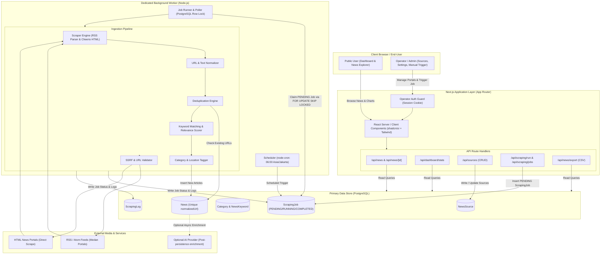

# POVERTYWATCH — TECHNICAL ARCHITECTURE PLAN
**Document:** `docs/TECHNICAL_PLAN.md`  
**Phase:** Phase 2 (Technical Planning & Architecture)  
**Version:** 1.0.0  
**Date:** November 2026  
**Status:** Approved Architectural Blueprint  

---

## 1. Executive Architecture Overview

PovertyWatch dirancang dengan arsitektur **Modular Monolith + Dedicated Background Worker** yang berbagi satu basis data PostgreSQL terpadu.

### 1.1 Core Principles
1. **Pemisahan Tanggung Jawab (Separation of Concerns):**  
   Next.js App Router melayani UI publik dan REST API, sedangkan Node.js Background Worker menangani scraping, parsing, deduplikasi, dan penjadwalan cron secara terisolasi. Siklus I/O scraping yang intensif tidak boleh mengganggu responsivitas antarmuka web.
2. **PostgreSQL sebagai Single Source of Truth & Coordination Engine:**  
   PostgreSQL menyimpan seluruh data relasional (*sources, news, categories, logs*) sekaligus bertindak sebagai queue / koordinasi task scraping menggunakan transaksi *row-level locking* (`FOR UPDATE SKIP LOCKED`).
3. **Provenance & Data Integrity:**  
   Setiap artikel berita wajib memiliki jejak asal sumber (*provenance*), canonical URL, URL yang dinormalisasi (*hash/dedup key*), serta log proses ingestion yang dapat diaudit.
4. **Metadata-First & Non-Intrusive Scraping:**  
   Menyimpan judul, ringkasan, tanggal terbit, nama entitas lokasi, dan link ke sumber asli. Tidak menyimpan naskah lengkap artikel tanpa izin hak cipta, serta mematuhi batas wajar request (*rate limit* dan header *User-Agent* yang transparan).
5. **No Microservices & No External Message Broker for MVP:**  
   Menolak kompleksitas RabbitMQ/Kafka/Redis di awal. PostgreSQL polling sudah terbukti tangguh dan hemat sumber daya untuk skala operasional MVP Kota Medan.

---

## 2. High-Level System Architecture Diagram



---

## 3. Layer Responsibilities & Boundaries

| Lapisan (Layer) | Cakupan Direktori | Tanggung Jawab Utama | Larangan Keras |
|---|---|---|---|
| **Presentation Layer** | `src/app/`, `src/components/` | Merender visual UI publik (Dashboard, News Explorer, Detail Berita) dan halaman operator (Sources, Scraping Management). Mengatur client state lokal dan validasi form input pengguna. | Dilarang memanggil database secara langsung tanpa Prisma repository/service, dilarang menjalankan logic scraping di browser. |
| **Application Layer** | `src/server/services/`, Route Handlers | Mengorkestrasi use-case bisnis: pencarian berita dengan pagination/filter, agregasi statistik dashboard, pemicuan scraping manual, verifikasi sesi operator. | Dilarang memanipulasi low-level DOM parsing atau scraping langsung di dalam request handler HTTP. |
| **Domain / Business Logic** | `src/server/processors/` | Algoritma normalisasi URL (stripping tracking query params seperti `utm_*`), penghitungan kesamaan teks, pencocokan kata kunci kemiskinan, klasifikasi kategori, penentuan skor relevansi. | Dilarang bergantung pada framework web (Next.js/React); harus berupa fungsi pure TypeScript yang mudah di-unit test. |
| **Data Access Layer** | `src/server/repositories/`, `src/lib/db/` | Abstraksi query database dengan Prisma Client. Menangani transaksi isolasi data, atomic update pada status job, dan query agregasi SQL. | Dilarang membocorkan raw SQL connection credentials ke luar server scope. |
| **Infrastructure Layer** | `src/server/scrapers/`, `worker/` | Implementasi fetch HTTP dengan SSRF protection, parsing RSS (via `rss-parser`), parsing HTML (via `cheerio`), structured logging (via `pino`), dan node-cron scheduling. | Dilarang mengabaikan proteksi SSRF dan dilarang bypass robots.txt/anti-bot protection tanpa izin. |

---

## 4. Final Project Folder Structure

Struktur direktori ini dirancang modular, clean, dan kompatibel dengan Next.js App Router serta TypeScript monorepo-lite:

```text
povertywatch/
├── docs/                               # Dokumentasi teknis & playbook
│   ├── PROJECT_PRD_AND_PLAYBOOK.md
│   ├── TECHNICAL_PLAN.md               # (Dokumen ini)
│   ├── UI_UX_GUIDE.md                  # Phase 3
│   ├── TEST_REPORT.md                  # Phase 9
│   ├── DEPLOYMENT_GUIDE.md             # Phase 10
│   └── RELEASE_NOTES.md
│
├── prisma/                             # Database schema & migrations
│   ├── schema.prisma
│   └── migrations/
│
├── public/                             # Asset statis publik
│   ├── images/
│   └── favicon.ico
│
├── src/
│   ├── app/                            # Next.js App Router
│   │   ├── (public)/                   # Route group publik
│   │   │   ├── page.tsx                # Public Dashboard
│   │   │   ├── news/                   # News Explorer & detail
│   │   │   │   ├── page.tsx
│   │   │   │   └── [id]/page.tsx
│   │   │   └── about/page.tsx
│   │   ├── (operator)/                 # Route group terproteksi operator
│   │   │   ├── admin/
│   │   │   │   ├── login/page.tsx
│   │   │   │   ├── sources/page.tsx
│   │   │   │   ├── scraping/page.tsx
│   │   │   │   └── settings/page.tsx
│   │   └── api/                        # REST Route Handlers
│   │       ├── news/
│   │       │   ├── route.ts
│   │       │   ├── [id]/route.ts
│   │       │   └── export/route.ts
│   │       ├── dashboard/
│   │       │   └── stats/route.ts
│   │       ├── sources/
│   │       │   ├── route.ts
│   │       │   └── [id]/route.ts
│   │       ├── scraping/
│   │       │   ├── run/route.ts
│   │       │   └── jobs/
│   │       │       ├── route.ts
│   │       │       └── [id]/route.ts
│   │       ├── categories/
│   │       │   └── route.ts
│   │       └── auth/
│   │           ├── login/route.ts
│   │           └── logout/route.ts
│   │
│   ├── components/                     # Reusable UI Components
│   │   ├── ui/                         # shadcn/ui primitives
│   │   ├── layout/                     # Header, Sidebar, Footer, Navbar
│   │   ├── dashboard/                  # StatCards, TrendChart, CategoryChart
│   │   ├── news/                       # NewsCard, FilterBar, SearchInput
│   │   ├── scraping/                   # JobTable, LogViewer, TriggerButton
│   │   └── shared/                     # EmptyState, ErrorBoundary, Pagination
│   │
│   ├── features/                       # Client state & feature hooks
│   │   ├── news/
│   │   ├── sources/
│   │   ├── scraping/
│   │   └── dashboard/
│   │
│   ├── lib/                            # Shared utilities & configurations
│   │   ├── db/                         # Prisma singleton client
│   │   │   └── prisma.ts
│   │   ├── auth/                       # Session & password helper
│   │   │   └── session.ts
│   │   ├── validation/                 # Zod validation schemas
│   │   │   ├── source.schema.ts
│   │   │   ├── news.schema.ts
│   │   │   └── scraping.schema.ts
│   │   ├── logger/                     # Pino logger instance
│   │   │   └── index.ts
│   │   └── utils.ts                    # Classnames & formatter helpers
│   │
│   ├── server/                         # Server-only logic (modular monolith)
│   │   ├── services/                   # Business use-cases
│   │   │   ├── news.service.ts
│   │   │   ├── source.service.ts
│   │   │   ├── scraping.service.ts
│   │   │   └── dashboard.service.ts
│   │   ├── repositories/               # Prisma data access
│   │   │   ├── news.repository.ts
│   │   │   ├── source.repository.ts
│   │   │   └── job.repository.ts
│   │   ├── scrapers/                   # Scraper Engine implementations
│   │   │   ├── base.scraper.ts
│   │   │   ├── rss.scraper.ts
│   │   │   └── html.scraper.ts
│   │   ├── processors/                 # Pipelines & algorithms
│   │   │   ├── url-normalizer.ts
│   │   │   ├── text-cleaner.ts
│   │   │   ├── keyword-matcher.ts
│   │   │   └── category-classifier.ts
│   │   └── security/                   # SSRF & IP validator
│   │       └── ssrf-guard.ts
│   │
│   └── types/                          # TypeScript definitions & DTOs
│       ├── news.d.ts
│       ├── source.d.ts
│       └── scraping.d.ts
│
├── worker/                             # Dedicated Node.js Background Worker
│   ├── index.ts                        # Entry point worker process
│   ├── scheduler.ts                    # node-cron scheduler (06:00 WIB)
│   ├── job-runner.ts                   # Poller & transactional executor
│   └── pipeline.ts                     # Ingestion pipeline orchestration
│
├── scripts/                            # Maintenance & verification scripts
│   ├── seed.ts                         # Initial sources, categories, keywords
│   └── verify-scraper.ts               # Standalone scraper test tool
│
├── tests/                              # Testing suites
│   ├── unit/                           # Normalizer, matcher, validator
│   ├── integration/                    # Scraper & database query test
│   └── e2e/                            # Playwright / API flows
│
├── .env.example
├── .gitignore
├── docker-compose.yml
├── Dockerfile
├── next.config.ts
├── package.json
└── tsconfig.json
```

---

## 5. Dependency Evaluation & Compatibility Matrix

Berdasarkan audit versi npm aktif, berikut evaluasi paket yang akan digunakan:

| Package | Evaluated Version | Purpose | Compatibility & Justification |
|---|---|---|---|
| `next` | `16.4.4` | Web Framework & API | Menggunakan App Router terbaru dengan Turbopack untuk performa kompilasi cepat. |
| `react` & `react-dom` | `19.3.0` | UI Library | Kompatibel penuh dengan Next.js 16.4.4. |
| `prisma` & `@prisma/client` | `^6.4.0` | ORM & Query Builder | Menggunakan versi v6 stabil (v7/v8 masih dalam rilis kandidat). Dukungan komprehensif untuk PostgreSQL 16. |
| `rss-parser` | `^3.13.0` | RSS/Atom Parser | Sangat stabil, teruji untuk parsing variasi format RSS 2.0 dan Atom feed media Indonesia. |
| `cheerio` | `^1.0.0` | Fast HTML DOM Parsing | Standar industri untuk static HTML parsing tanpa overhead Chromium/Puppeteer. Sangat ringan untuk VPS kecil. |
| `node-cron` | `^3.0.3` | In-process Task Scheduler | Ringan, mendukung ekspresi cron standar dengan konfigurasi timezone `Asia/Jakarta`. |
| `pino` & `pino-pretty` | `^9.5.0` | Structured Logging | JSON logging berkecepatan tinggi dengan overhead CPU minimal, cocok untuk audit scraping log. |
| `zod` | `^3.24.0` / `^4.0` | Runtime Validation | Type-safe schema validation untuk HTTP requests, environment variables, dan scraper outputs. |
| `iron-session` | `^8.0.4` | Encrypted Session Cookie | Stateless, aman, tidak membutuhkan session table di database untuk otentikasi admin MVP. |

---

## 6. Database Schema Design (Prisma Data Model Draft)

Database menggunakan **PostgreSQL 16**. Seluruh entitas memiliki relasi terstruktur dan indeks optimal untuk query analitik.

```prisma
datasource db {
  provider = "postgresql"
  url      = env("DATABASE_URL")
}

generator client {
  provider = "prisma-client-js"
}

enum SourceType {
  RSS
  HTML
}

enum Frequency {
  DAILY
  WEEKLY
  MONTHLY
}

enum JobStatus {
  PENDING
  RUNNING
  COMPLETED
  FAILED
}

enum TriggerType {
  MANUAL
  SCHEDULED
}

enum LogLevel {
  INFO
  WARNING
  ERROR
}

model NewsSource {
  id              String         @id @default(uuid())
  name            String         @db.VarChar(150)
  baseUrl         String         @db.VarChar(500)
  feedUrl         String?        @db.VarChar(500)
  type            SourceType     @default(RSS)
  isActive        Boolean        @default(true)
  scrapeFrequency Frequency      @default(DAILY)
  selectorConfig  Json?          // Selector konfigurasi HTML scraper: { itemSelector, titleSelector, linkSelector, dateSelector }
  lastScrapedAt   DateTime?
  createdAt       DateTime       @default(now())
  updatedAt       DateTime       @updatedAt

  news            News[]
  scrapingJobs    ScrapingJob[]
  scrapingLogs    ScrapingLog[]

  @@index([isActive])
}

model Category {
  id          String        @id @default(uuid())
  name        String        @db.VarChar(100)
  slug        String        @unique @db.VarChar(100)
  description String?       @db.VarChar(500)
  isActive    Boolean       @default(true)
  createdAt   DateTime      @default(now())
  updatedAt   DateTime      @updatedAt

  news        News[]
  keywords    NewsKeyword[]

  @@index([slug])
}

model NewsKeyword {
  id         String   @id @default(uuid())
  categoryId String
  keyword    String   @db.VarChar(100)
  isActive   Boolean  @default(true)
  createdAt  DateTime @default(now())
  updatedAt  DateTime @updatedAt

  category   Category @relation(fields: [categoryId], references: [id], onDelete: Cascade)

  @@index([categoryId])
  @@index([keyword])
}

model News {
  id            String    @id @default(uuid())
  sourceId      String
  categoryId    String?
  title         String    @db.VarChar(500)
  url           String    @db.Text
  normalizedUrl String    @unique @db.Text  // Hash / Canonical URL untuk mencegah duplikasi
  description   String?   @db.Text
  content       String?   @db.Text
  author        String?   @db.VarChar(150)
  imageUrl      String?   @db.Text
  publishedAt   DateTime?
  locationName  String?   @db.VarChar(150)  // Contoh: "Medan Sunggal", "Medan Belawan"
  locationLevel String?   @db.VarChar(50)   // Contoh: "KECAMATAN", "KOTA"
  aiSummary     String?   @db.Text
  isRelevant    Boolean   @default(true)
  createdAt     DateTime  @default(now())
  updatedAt     DateTime  @updatedAt

  source        NewsSource @relation(fields: [sourceId], references: [id], onDelete: Restrict)
  category      Category?  @relation(fields: [categoryId], references: [id], onDelete: SetNull)

  @@index([publishedAt(sort: Desc)])
  @@index([categoryId])
  @@index([sourceId])
  @@index([isRelevant])
}

model ScrapingJob {
  id             String      @id @default(uuid())
  sourceId       String?     // Null jika batch job mencakup seluruh sumber aktif
  status         JobStatus   @default(PENDING)
  triggerType    TriggerType @default(SCHEDULED)
  startedAt      DateTime?
  finishedAt     DateTime?
  totalFound     Int         @default(0)
  totalNew       Int         @default(0)
  totalDuplicate Int         @default(0)
  totalFailed    Int         @default(0)
  errorMessage   String?     @db.Text
  createdAt      DateTime    @default(now())
  updatedAt      DateTime    @updatedAt

  source         NewsSource? @relation(fields: [sourceId], references: [id], onDelete: SetNull)
  logs           ScrapingLog[]

  @@index([status, createdAt])
}

model ScrapingLog {
  id        String      @id @default(uuid())
  jobId     String
  sourceId  String?
  level     LogLevel    @default(INFO)
  message   String      @db.Text
  details   Json?
  createdAt DateTime    @default(now())

  job       ScrapingJob @relation(fields: [jobId], references: [id], onDelete: Cascade)
  source    NewsSource? @relation(fields: [sourceId], references: [id], onDelete: SetNull)

  @@index([jobId])
  @@index([level])
}
```

---

## 7. API Design & Contracts

Format response standar untuk seluruh API:
```typescript
interface ApiResponse<T> {
  success: boolean;
  data?: T;
  error?: {
    code: string;
    message: string;
    details?: unknown;
  };
  meta?: {
    page?: number;
    limit?: number;
    total?: number;
    totalPages?: number;
  };
}
```

### 7.1 News Endpoints
- **`GET /api/news`**
  - **Query Params:** `page` (default: 1), `limit` (default: 20), `search` (string), `categoryId` (uuid), `sourceId` (uuid), `location` (string), `startDate` (ISO), `endDate` (ISO).
  - **Response 200:** Array of `News` dengan relasi `source` dan `category`, beserta metadata paginasi.
- **`GET /api/news/[id]`**
  - **Response 200:** Detail satu artikel berita beserta metadata lengkap dan provenance.
- **`GET /api/news/export`**
  - **Headers:** `Content-Type: text/csv`, `Content-Disposition: attachment; filename="povertywatch_news.csv"`
  - **Query Params:** Sama dengan `/api/news` untuk export data terfilter.

### 7.2 Analytics & Dashboard Endpoints
- **`GET /api/dashboard/stats`**
  - **Response 200:**
    ```json
    {
      "success": true,
      "data": {
        "totalArticles": 1240,
        "last24Hours": 45,
        "categoryDistribution": [
          { "categoryId": "...", "name": "Kemiskinan Ekstrem", "count": 320 },
          { "categoryId": "...", "name": "Stunting & Gizi Buruk", "count": 210 }
        ],
        "coverageTrend": [
          { "date": "2026-11-01", "count": 28 },
          { "date": "2026-11-02", "count": 35 }
        ],
        "topSources": [
          { "sourceId": "...", "name": "Waspada Medan", "count": 450 }
        ],
        "districtDistribution": [
          { "district": "Medan Belawan", "count": 84 },
          { "district": "Medan Labuhan", "count": 62 }
        ]
      }
    }
    ```

### 7.3 Sources Management Endpoints (Operator Auth Required)
- **`GET /api/sources`**: Daftar seluruh sumber berita dengan status aktif/nonaktif dan riwayat scrape terakhir.
- **`POST /api/sources`**: Tambah sumber berita baru.
  - **Payload:** `{ name, baseUrl, feedUrl?, type: "RSS" | "HTML", scrapeFrequency, selectorConfig? }`
  - **Validation:** Zod Schema + SSRF validation.
- **`PATCH /api/sources/[id]`**: Update konfigurasi sumber berita.
- **`DELETE /api/sources/[id]`**: Hapus atau nonaktifkan sumber berita.

### 7.4 Scraping Control Endpoints (Operator Auth Required)
- **`POST /api/scraping/run`**
  - **Payload:** `{ sourceId?: string }` (Jika `sourceId` kosong, mentrigger semua sumber aktif).
  - **Action:** Menyisipkan record baru ke `ScrapingJob` dengan status `PENDING`.
  - **Response 202 (Accepted):** `{ success: true, data: { jobId: "..." } }`
- **`GET /api/scraping/jobs`**: Riwayat eksekusi scraping job dengan filter status.
- **`GET /api/scraping/jobs/[id]`**: Detail status job, statistik (`totalFound, totalNew, totalDuplicate, totalFailed`), dan daftar log eksekusi.

---

## 8. Scraper Architecture & Processing Pipeline

### 8.1 Unified Scraper Contract
```typescript
export interface ScrapedItem {
  title: string;
  url: string;
  publishedAt?: Date;
  description?: string;
  content?: string;
  author?: string;
  imageUrl?: string;
}

export interface ScrapeResult {
  items: ScrapedItem[];
  errors: string[];
}

export interface INewsScraper {
  scrape(source: NewsSource): Promise<ScrapeResult>;
}
```

### 8.2 Scraping Execution Step-by-Step

```
[1. Fetch Source]
       │  (Fetch RSS XML / HTML lewat Native Fetch + Timeout 10s + SSRF Check)
       ▼
[2. Parse Document]
       │  (RssParser untuk RSS/Atom, Cheerio dengan declarative selectors untuk HTML)
       ▼
[3. Validate Minimum Fields]
       │  (Harus memiliki minimal: title [min 5 char] dan valid HTTP URL)
       ▼
[4. Normalize URL]
       │  (Hapus tracking params: utm_*, fbclid, ref; bersihkan trailing slash)
       ▼
[5. Normalize Text]
       │  (Decode HTML entities, buang tag script/style, trim whitespace)
       ▼
[6. Deduplication Check]
       │  (Query database: WHERE normalizedUrl = ? -> Jika ada: catat totalDuplicate, lewati)
       ▼
[7. Keyword Matching & Relevance Scoring]
       │  (Cocokkan judul & ringkasan terhadap tabel NewsKeyword; hitung bobot kemiskinan)
       ▼
[8. Categorization & Location Extraction]
       │  (Petakan ke Category tertinggi; deteksi kata kunci kecamatan Kota Medan)
       ▼
[9. Persistence Transaction]
       │  (Prisma create news; commit ke database)
       ▼
[10. Audit Logging]
          (Tulis metrik ke ScrapingJob dan detail log ke ScrapingLog)
```

### 8.3 URL Normalization Strategy
Untuk mencegah duplikasi akibat variasi query parameter:
1. Parse URL menggunakan objek `new URL(rawUrl)`.
2. Hapus parameter pelacak: `utm_source`, `utm_medium`, `utm_campaign`, `utm_term`, `utm_content`, `fbclid`, `gclid`, `ref`, `source`, `ocid`.
3. Lowercase nama domain (hostname).
4. Buang trailing slash (`/`) pada pathname jika bukan root.
5. Simpan URL asli di kolom `url` dan versi bersih di kolom `normalizedUrl` (yang memiliki constraint `@unique`).

---

## 9. Background Worker Architecture & Lifecycle

Worker dijalankan sebagai **Node.js process mandiri** (`tsx worker/index.ts` pada dev, `node dist/worker/index.js` pada prod).

### 9.1 Scheduler (node-cron)
- Jadwal harian berjalan pukul **06:00 WIB (`0 6 * * *`)** dengan konfigurasi:
  ```typescript
  cron.schedule("0 6 * * *", () => scheduleDailyScraping(), {
    scheduled: true,
    timezone: "Asia/Jakarta"
  });
  ```
- Scheduler hanya bertugas membuat record `ScrapingJob` dengan status `PENDING` di PostgreSQL, tidak langsung menjalankan network request.

### 9.2 Transactional Job Claiming (PostgreSQL Lock)
Untuk mencegah *race condition* jika worker direstart atau terdapat beberapa worker instance:
```sql
UPDATE "ScrapingJob"
SET status = 'RUNNING', "startedAt" = NOW()
WHERE id = (
  SELECT id FROM "ScrapingJob"
  WHERE status = 'PENDING'
  ORDER BY "createdAt" ASC
  LIMIT 1
  FOR UPDATE SKIP LOCKED
)
RETURNING *;
```
1. Worker melakukan polling ke tabel `ScrapingJob` setiap 5–10 detik.
2. Menggunakan query di atas untuk mengunci dan mengambil satu job secara atomic.
3. Setelah selesai, status diubah menjadi `COMPLETED` atau `FAILED` beserta metrik eksekusi.

### 9.3 Graceful Shutdown Handling
Worker menangkap sinyal `SIGINT` dan `SIGTERM`:
- Berhenti mengambil job baru dari antrean.
- Tunggu artikel yang sedang dalam tahap persistensi (diberikan batas waktu grace period 15 detik).
- Catat status job yang belum selesai agar dapat di-recover saat worker menyala kembali.

---

## 10. Security Architecture & Threat Mitigation

### 10.1 SSRF (Server-Side Request Forgery) Defense-in-Depth
Karena URL portal berita dimasukkan oleh operator atau diproses otomatis oleh worker, sistem menerapkan validasi berlapis:
1. **Skema URL:** Hanya mengizinkan protokol `http:` dan `https:`.
2. **DNS & IP Validation:** Sebelum melakukan request HTTP, resolve alamat domain ke IP:
   - Tolak alamat loopback (`127.0.0.0/8`, `::1`).
   - Tolak private network RFC 1918 (`10.0.0.0/8`, `172.16.0.0/12`, `192.168.0.0/16`).
   - Tolak Link-Local (`169.254.0.0/16` — AWS/GCP metadata service endpoint).
3. **Redirect Hop Limit:** Maksimum 3 redirect; setiap tujuan redirect wajib melalui verifikasi IP yang sama.
4. **Ukuran Payload & Timeout:** Maksimum ukuran respons 5 MB dan batas waktu request 10 detik.

### 10.2 Operator Authentication
- Menggunakan cookie HTTP-only terenkripsi (`ADMIN_SESSION_SECRET`).
- Halaman publik (Dashboard, News Explorer, Detail Artikel) tidak membutuhkan autentikasi.
- Endpoint sensitif (`/api/sources/*`, `/api/scraping/run`, `/admin/*`) dijaga oleh middleware autentikasi.
- Rate limiting berbasis IP untuk mencegah brute force pada form login operator dan endpoint pemicu scraping.

### 10.3 Compliance & Ethical Scraping
- Header `User-Agent` wajib menyatakan identitas: `PovertyWatch-Bot/1.0 (+https://povertywatch.id/about-bot)`.
- Request diberi delay minimal 1–2 detik antar artikel dari domain yang sama agar tidak membebani server media lokal.
- Hanya mengumpulkan judul, ringkasan/lead, tanggal terbit, dan tautan asli; tidak mengambil full content tanpa izin.

---

## 11. Deployment Architecture & Topology

Target deployment untuk rilis MVP adalah **Single VPS (Ubuntu 24.04 LTS, min. 2 vCPU, 4GB RAM)**:

```
[ Internet Traffic ]
        │
        ▼ (Port 80/443 HTTPS)
┌────────────────────────────────────────────────────────┐
│ Nginx / Caddy (Reverse Proxy + Auto Let's Encrypt TLS)   │
└───────────────────────┬────────────────────────────────┘
                        │
       ┌────────────────┴────────────────┐
       ▼ (Port 3000)                     ▼
┌──────────────────────────┐    ┌──────────────────────────┐
│ Docker: Next.js Web App  │    │ Docker: Background Worker│
│ (Production Node Server) │    │ (node-cron + Scrapers)   │
└──────────────┬───────────┘    └────────────┬─────────────┘
               │                             │
               └──────────────┬──────────────┘
                              ▼ (Port 5432 - Internal Network)
               ┌─────────────────────────────┐
               │ Docker: PostgreSQL 16 DB    │
               │ (Persistent Docker Volume)  │
               └─────────────────────────────┘
```

### 11.1 Process Management
- Dikelola melalui `docker-compose.yml` dengan tiga container: `web`, `worker`, dan `postgres`.
- Database data disimpan di volume terisolasi dengan backup harian otomatis (`pg_dump` via cron host).

---

## 12. Technical Risk Assessment & Mitigation Plan

| Risiko Teknis | Dampak | Probabilitas | Rencana Mitigasi |
|---|---|---|---|
| **Struktur HTML Portal Media Berubah** | Scraper HTML gagal mengambil artikel | Sedang | Pisahkan selector ke kolom JSON `selectorConfig` di database sehingga operator dapat mengupdate selector tanpa perlu redeploy kode. |
| **RSS Feed Portal Tidak Lengkap / Rusak** | Ingestion terhenti | Sedang | Sediakan mekanisme fallback ke HTML scraper dan catat error ke `ScrapingLog` dengan alert status. |
| **IP Diblokir oleh Portal Media** | Gagal mengambil data | Rendah-Sedang | Gunakan rate limiting santun (1 req / 2 detik per host), rotasi User-Agent yang transparan, dan dahulukan RSS feed publik. |
| **Worker Mengalami Crash saat Scraping** | Job tergantung pada status `RUNNING` | Rendah | Buat mekanisme *stale job recovery* saat worker startup (mereset job `RUNNING` yang lebih dari 30 menit menjadi `FAILED`). |
| **Duplikasi Berita Akibat Variasi URL** | Statistik liputan menjadi bias | Tinggi | Implementasikan normalisasi URL kanonikal dan constraint unik di basis data pada kolom `normalizedUrl`. |

---

## 13. Kesimpulan & Status Kesiapan
Rencana arsitektur teknis ini telah diverifikasi terhadap seluruh batasan PRD. Arsitektur ini siap digunakan sebagai acuan mutlak untuk:
- **Phase 3:** Desain UI/UX & Design System.
- **Phase 4–5:** Implementasi Antarmuka Frontend.
- **Phase 6–7:** Implementasi Database Schema, API Route Handlers, dan Scraper Pipeline.
